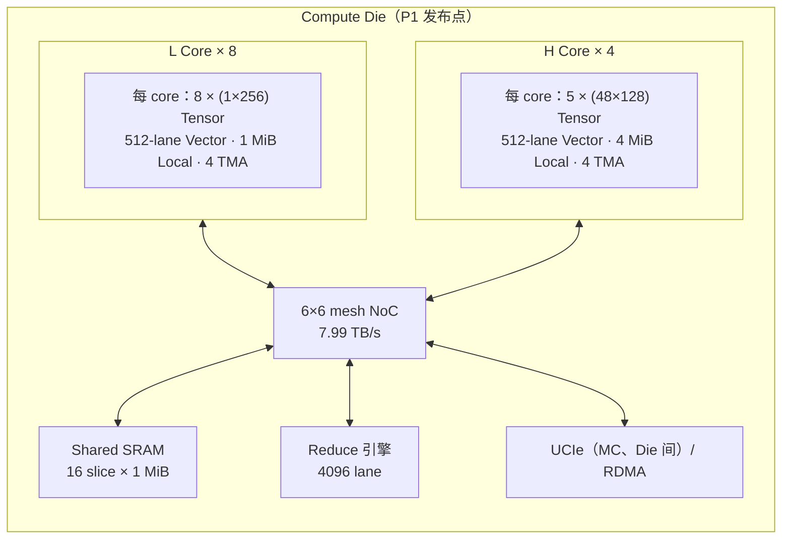
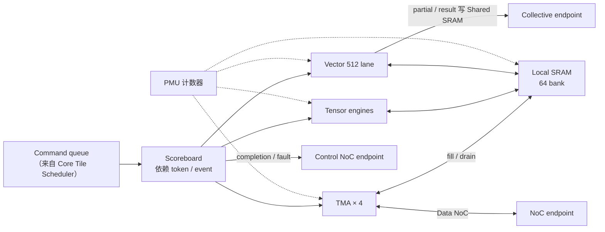
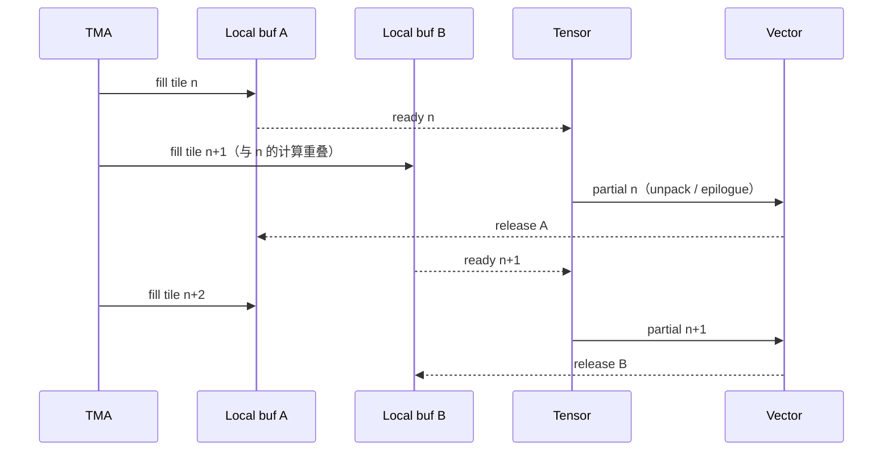
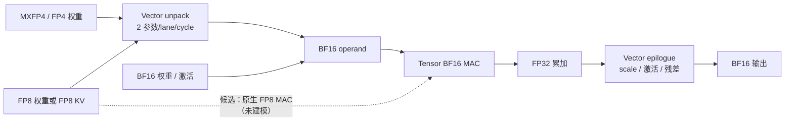
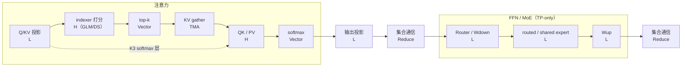
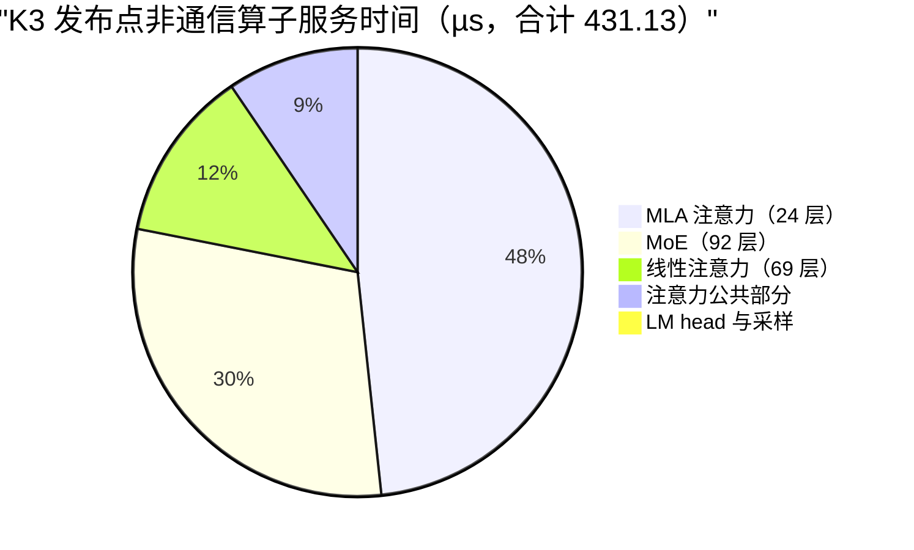

# AI Core 子系统设计

- 所有者：Hardware（AI Core）；共签：Software SW-03（kernel）
- 状态：`BASELINE`（单元规格来自模型推导，未经 RTL/综合回标，见 B-006）
- 数字口径：**唯一硬件规格 P1 的发布点**（8 L + 4 H、1.0 GHz，ADR-0021），权威值在
  `teams/hardware/inputs/k3_mc_baseline.json#tpsDesign.hardware`；Die 级汇总见
  [`01_SYSTEM_ARCHITECTURE.md`](../../../docs/architecture/01_SYSTEM_ARCHITECTURE.md) 第 2.1 节。
  本文数字与 [`21_TPS_DESIGN_BASELINE.md`](../../../docs/architecture/21_TPS_DESIGN_BASELINE.md) 第 3.2 节冲突时，以 21 号文档为准。

## 1. 目标与边界

AI Core 负责 Tensor、Vector 和局部数据编排。本文冻结到单元级，不展开
Tensor PE 内部、乘法器实现、寄存器文件 bitcell 或具体流水级。

当前采用异构 Core：

- L Core：面向 GEMV、Skinny GEMM、Decode FFN 和低复用投影；
- H Core：面向 Attention QK/PV、线性注意力 state、indexer 打分等高复用矩阵；
- Vector：RMSNorm、RoPE、Softmax、SiLU、Top-k、权重 unpack、FP8 KV 反量化；
- TMA：Shared SRAM 与 Local SRAM 之间的 tile 搬运（见 [03](03_TMA_AND_SRAM.md)）。



## 2. 单 Die 基线

| 单元 | 数量 | 频率 | 主要规格 | 峰值 / Die | 状态 |
| --- | ---: | ---: | --- | ---: | --- |
| L Core | 8 | 1.0 GHz | 每 Core 8 × (1×256) Tensor engine | 32.77 TFLOPS BF16 | `BASELINE` |
| H Core | 4 | 1.0 GHz | 每 Core 5 × (48×128) Tensor engine | 245.76 TFLOPS BF16 | `BASELINE` |
| Vector | 12 | 1.0 GHz | 每 Core 512 lane | 12.29 TOPS | `MODEL` |
| TMA | 12 组 | 1.0 GHz | 每 Core 4 engine × 512 B/cycle | 1.64 TB/s/core（有效） | `MODEL`（O-007） |
| Reduce | 1 | 1.0 GHz | 4096 lane | 2.66 TOPS | `MODEL` |

频率固定 1.0 GHz，不参与搜索（21 号文档第 1.1 节）：算力只能通过 core 数、engine 数和阵列形状调整。

### 2.1 L Core

每 Core：

- 8 个逻辑 Tensor engine，每 engine 每周期 1×256 个 BF16 MAC，合计 2048 MAC/cycle；
- 1 MiB Local SRAM，64 bank × 64 B，读 3.07 TB/s（bank 利用率 0.75）；
- 512-lane Vector，承担 MXFP4 unpack（每 lane 每周期 2 个参数）；
- 4 个 TMA engine。

```text
8 core × 8 engine × 1 × 256 MAC × 2 FLOP × 1.0 GHz = 32.768 TFLOPS/Die
```

### 2.2 H Core

每 Core：

- 5 个逻辑 Tensor engine，每 engine 每周期 48×128 个 BF16 MAC，合计 30720 MAC/cycle；
- 4 MiB Local SRAM，64 bank × 64 B，读 3.07 TB/s；
- 512-lane Vector，承担 online softmax、FP8 KV 反量化；
- 4 个 TMA engine。

```text
4 core × 5 engine × 48 × 128 MAC × 2 FLOP × 1.0 GHz = 245.76 TFLOPS/Die
```

单 Die BF16 Dense 峰值合计 327.68 TFLOPS（L 32.77 + H 294.91）。这是数学峰值，不是可持续性能。

### 2.3 峰值与模型可持续值

模型对所有矩阵算子乘矩阵利用率 0.65，对向量算子乘 0.35，另乘 layout imbalance 1.15（`A.TECH`，固定假设，不是可调旋钮）。

```mermaid
xychart-beta
  title "每 Die 峰值与模型可持续值（TFLOPS / TOPS）"
  x-axis ["L Tensor", "H Tensor", "Vector", "Reduce"]
  y-axis "T/s" 0 --> 260
  bar [32.77, 245.76, 12.29, 2.66]
  bar [21.30, 159.74, 4.30, 1.73]
```



第一组为峰值，第二组为乘利用率后的值（L/H × 0.65，Vector × 0.35，Reduce × 0.65）。

**关于 88%：** 早期 Final Tuning 在 `OPT.matrixUtil` 登载过 0.88，但 `mappedPlan()` 用 `TECH.matrixUtil = 0.65`
算完时长后不再重算，0.88 从未生效；2026-09-25 起 `OPT` 中已删除两个利用率键，由测试断言（`tests/regression/test_k3_rdma_final_tuning.js`）。
若要提高到 0.88，需 SW-03 在 [`KERNEL_SPEC.md`](../../software/docs/KERNEL_SPEC.md) 中给出 kernel 级证据。

### 2.4 关键时延参数（模型值）

| 参数 | 值 | 含义 | 来源 |
| --- | ---: | --- | --- |
| `tmaSetupCycles` | 16 cycle | 每次 TMA 装载的固定建立时间 | `A.TECH` |
| `routerCycles` | 2 cycle/hop | NoC 每跳时延；6×6 mesh 按 6 跳计 12 cycle | `A.TECH` |
| `launchUs` × `launchScale` | 0.015 µs × 0.45 | 每个未融合算子的发射开销 | `A.TECH`、`OPT`（B-003） |
| `unpackParamsPerLaneCycle` | 2 | MXFP4/FP8 → BF16 的向量解包速率 | `A.TECH` |
| `ucieHopUs` | 0.025 µs | 每次跨 Die 跳 | `A.TECH` |

### 2.5 Matrix:Vector 配比（HW-02 决策）

- 所有者：HW-02 AI-Core；共签：SW-03（kernel 的 vector 操作计数）
- 状态：`MODEL`（设计空间搜索：逐 kernel 解析上限 + K3 详细模型回放，不是 `FROZEN`；不改发布点）
- 设计空间（全部备选及其 ASSUMPTION）：`teams/hardware/inputs/matrix_vector_design_space.json`
- 搜索：`integration/detailed/matrix_vector_search.js`；`npm run aicore:search` 把最终方案写到
  `out/detailed/matrix_vector_design.json`（没有可行方案时写“无方案”记录，不选最不坏的一个），完整候选集写到
  `out/detailed/matrix_vector_candidates.json`。本节数字由 `tests/regression/test_matrix_vector_design.js`
  对照新鲜搜索结果检查。

**口径**：配比 = BF16 dense 矩阵峰值 : vector 峰值（lanes × 2 × f），等价于 MAC : lane。
P1 发布点每 Die **13.3:1**，但它是两类核的平均：L Core **4.0:1**，H Core **32.0:1**（`vectorLanes` 为 1024；ADR-0028 把 L Core 定为 1×512×8 = 4096 MAC（8.19 TFLOPS）、H Core 定为 128×256×1 = 32768 MAC（65.54 TFLOPS），旧定义是 L 2048 MAC / H 36864 MAC：L Core 配比翻倍 2.0→4.0，H Core 配比 36.0→32.0）。
配比必须按核类分开看，不能只给一个整 Die 数。

**判据（逐 kernel 掩盖）**：每个融合 kernel 的 vector 部分不长于同一 kernel 的矩阵部分：

```text
vector lane-cycles / lanes  <=  matrix FLOPs / (2 × MACs × matrixUtil × fill)
=>  核内 MAC:lane  <=  matrix FLOPs / (2 × matrixUtil × fill × vector lane-cycles)
```

通用 vector 操作按 `TECH.vectorUtil` 折算，解包/反量化按 `TECH.unpackParamsPerLaneCycle` 计，与 `mappedPlan()` 一致。
上限与 lanes 无关，所以每个 kernel 给出一个最少 lanes：`MAC / 上限`。

#### 2.5.1 设计空间与搜索

| 维度 | 选项 | 依据 |
| --- | --- | --- |
| `vectorLanes` | 256–1024，步长 64（13 个），P1 为 1024 | 模型中 L/H 共用一个 `vectorLanes` |
| `lowPrecisionInput` | `vectorUnpack`：张量核只吃 BF16，FP8/MXFP4 权重、FP8 KV、FP8 index key 都在 vector 上解包（P1）；`nativeTensor`：张量核直接吃 FP8 E4M3 / MXFP4（多精度 MAC 阵列），矩阵面积 +8%；`inlineDequant`：**随路解码**——在 Local SRAM 与 BF16 MAC 阵列之间加一级操作数解码，元素只做位宽展开，block scale 不逐元素乘，而是每 block 一次加到部分和上（MXFP4 的 E8M0 scale 沿 K 每 32 权重一次做指数加；FP8 KV 的 FP32 scale 每 128 维一次：QK 在累加器上按 K block 乘，PV 按输出列乘），Local SRAM 里始终是压缩字节，MAC 阵列保持单格式 BF16；时间与 `nativeTensor` 相同（解包和 KV 反量化都离开 vector lane），只有面积不同，矩阵面积 +3% | O-012；8% 是 ASSUMPTION（多精度 MAC 常见 5–15%，不是本阵列证据）；3% 是**占位 ASSUMPTION**（按每个权重侧元素约 40 门的解码器加每 block 一个 scale 加/乘器，对比每个 BF16 MAC 约 1500–2500 门推导，不是宏数据），待 HW-02 签核；盈亏平衡点（2.5.4）说明它可以错到多少才翻转 |
| `expUnit` | `sfu`：exp/倒数 SFU，softmax 8 op/score，vector 面积 +10%；`polynomial`：ALU 上做范围规约 + 多项式，18 op/score，无额外面积 | O-006，ASSUMPTION |

不搜索、已裁定的维度（理由见设计空间 `ruled`）：L/H 共用一个 lane 数（模型只有一个 `vectorLanes`；分核类配置省面积，待扩展 `A.physical()` / `mappedPlan()` 后再搜）；
不在 TMA 通路上解码（写入 Local SRAM 的 BF16 字节翻 2–4 倍，O-007 的写端口模型尚未计入；这条反对的是在 Local SRAM **之前**解码，`inlineDequant` 在 Local SRAM 之后解码，不受它约束）；B=1 decode（B 最高 16 的 GEMV 上限只作敏感度）。
`inlineDequant` 的前提：Tile IR 的 operand descriptor 要带 block 大小和 scale 指针（MXFP4 沿 K 每 32；FP8 KV 在 QK 沿 K 每 128、在 PV 沿 N 每 128），这是 `docs/architecture/contracts/` 的契约变更。

**发布点的记账**：发布点 372.53 mm²（295.09 W）= 364.76 mm² + 7.78 mm²（共享端口放大，ADR-0023 把 `localWriteRatio` 从 1.70 降到 1 之后；之前端口放大是 16.15 mm²）。下文所有面积、功耗都是这一口径，候选的面积直接与它和 400 mm²、封装窗口比较。

**约束**：

1. 三个模型（K3、GLM-5.2、DeepSeek-V4-Pro）的全部 H Core kernel（MLA、DSA indexer、KDA state）可掩盖；
   L Core 的 B=1 GEMV 解包只报告、不作要求，它的时间由 K3 系统回放计入；
2. K3 详细模型在发布点只改 lanes、解包（原生输入时关掉）和 softmax op 数回放，TPS/usr 满足 L1 合同的 `B-SERIAL-CMP` 条目（`target.tpsPerUser` = 1000；`out/requirements/budget_frontier.json` 的 `S-CMP`，见 [23](../../council/docs/23_DESIGN_QUESTION_WORKFLOW_PROPOSAL.md)）；
   本合同条目与"不低于发布值 99.9%"（1042.92）是两条不同的判据：搜索只回答前者。发布点 1043.96 TPS/usr 距离 1000 只有 43.96 的余量，判据放宽到 1000 后，384 lane 配随路解码与 SFU（1015.34）仍满足，取舍落到面积上；
3. Die 面积和功耗在限值内（`O.evaluate` 可行性，面积上限 400 mm²）。面积和功耗都**含共享端口放大**（发布点 +7.78 mm²、+2.74 W / Die，`O.chargeSharedPortCost`）和选项开销；
   早期版本只用 `P.resize(A.physical(x))` 的面积，漏掉端口放大，发布点显示 364.76 mm² 而不是 372.53 mm²；
4. 封装放得下：`8 × 面积 + 16 × 100 ≤ 5248 × (1 − 0.1254)`（8 个 Die、16 个 memory cube、放置窗口 5248 mm²）。
   0.1254 是发布点的**观测** keep-out（658.29 / 5248，`physical_design_space.json`），不是核实过的下限；更小的预留是未证实的假设，这里不用它放行任何候选。
   发布点本身还剩 9.62 mm²（ADR-0028 之前 96.47 mm²，ADR-0023 之前 0.19 mm²），平摊到 8 个 Die，每个 Die 最多再加 1.20 mm²。

**目标**：可行优先，然后 Die 面积（含端口放大与选项开销）最小，然后功耗最小。都不可行时不选方案；排序只用来指出最接近的一个（违反的限值最少、能回放的优先）。
expUnit 通过模拟器的 `softmaxOpsPerScore`（`k3_operator_sram_sim.js`，默认 8）进入 K3 回放，所以多项式 exp 的代价同时反映在 kernel 上限和系统 TPS 上。

搜索共 78 个组合、26 个可行，设计空间 sha256 前缀 `ed0c52e99c15`。

#### 2.5.2 结论

> **这是 HW-02 搜索的推荐，不是基线。** 当前基线（`k3_mc_baseline.json`、ADR-0021、ADR-0026、ADR-0028）仍是每 Core 1024 lane、vector 解包、Die 372.53 mm²、封装余量 9.62 mm²；
> 下表的 384 lane、随路解码、362.63 mm²、余量 88.88 mm² 属于搜索胜出方案。要把它写进基线，需要改 `OPT`、重跑 `search:final` 和 `baseline:sync`（ADR-0005 第 5 条）并另立 ADR；
> 而且 `inlineDequant` 的 3% 面积是占位 ASSUMPTION（2.5.1），胜出以 HW-02 签核为前提。

| 维度 | 选项 |
| --- | --- |
| `vectorLanes` | `384` |
| `lowPrecisionInput` | `inlineDequant` |
| `expUnit` | `sfu` |

- 配比：整 Die **35.6:1**，L Core **10.7:1**，H Core **85.3:1**。
- 绑定约束：DeepSeek-V4-Pro DSA indexer（FP8 key 随路解码后，vector 上只剩 top-k 与 ReLU/加权），上限 87.8:1，至少 373.3 lane；取网格上的 384。
- K3 回放 1015.34 TPS/usr（发布值 1043.96），raw 841.79 µs，掩盖与 `B-SERIAL-CMP` 都满足。
- 面积 362.63 mm²（Die 350.04 mm² + 共享端口 7.78 mm² + 矩阵解码 3.92 mm² + SFU 0.88 mm²），功耗 285.1 W。
- 封装余量 **88.88 mm²**，比发布点的 9.62 mm² 多 79.26 mm²，比上一版胜出方案（576 / vectorUnpack / sfu，81.43 mm²）多 7.45 mm²（见 2.5.3）。
- 胜出方案的 TPS 比发布点低 28.62（−2.7%）：发布点用 1024 lane，胜出方案只配 384。这是搜索目标造成的——它的第一排序准则是面积，K3 回放只需要不低于合同的 1000。**这不是"384 更快"，而是"384 更省面积且仍达标"**，达标余量 15.34 TPS/usr，比上一版 576 / vectorUnpack 的 9.90 厚一些。
- **随路解码把 lane 数从 576 压到 384 的机制**：`vectorUnpack` 下 B=1 GEMV 的解包在 L Core 7.1:1 时已掩盖不住（上限 3.1:1），lane 一降解包就吃 TPS，576 是它的下限；随路解码把解包和 KV 反量化都移出 vector lane，vector 只剩 softmax / norm / SiLU / top-k，lane 数就只由 DeepSeek-V4-Pro indexer 的 top-k 决定（原生上限 87.8:1 → 373.3 lane）。省下的 192 lane 的面积（约 10.5 mm²，含 SFU）大于解码器的 3.92 mm²。
- 胜出方案**用 SFU**：384 lane 下多项式 exp 回放 957.91，达不到 1000；所以 SFU 多付的 0.88 mm² 是必要的。
- `nativeTensor`（多精度 MAC，+8%）与 `inlineDequant` 回放完全相同（同为 384 lane、1015.34），只差矩阵面积开销：369.17 对 362.63 mm²。两者的盈亏平衡点同为 3.7%（2.5.4）：3% 在它之下所以随路解码胜出；8% 在它之上所以多精度 MAC 落选。**3% 与 3.7% 只差 0.7 个百分点**——HW-02 签核的面积若高于 3.7%，赢家回到 576 / vectorUnpack。

三个模型的 H Core kernel 都要掩盖，随路解码下至少需要 373.3 lane / Core（`hEngines` 为 1，最少 lane = H Core 的 MAC 数 ÷ 87.78 上限）；vector 解包下是 454.6 lane。

#### 2.5.3 各备选的落选原因

每个选项取包含它的最优组合（不可行组合按"违反的限值最少、能回放的优先、再按面积"排序）。
`hKernelExposed` = 有 H Core kernel 掩盖不住；`belowContractTarget` = K3 回放低于 `B-SERIAL-CMP` 的 `target.tpsPerUser`（1000）；`systemInfeasible` = 详细模型判为不可行（此行面积不含端口放大，回放没有产出它）；
`dieArea` = Die 面积超过 `B-AREA` 的 400 mm²；`packageArea` = 8 个 Die 加 memory cube 超出放置窗口扣掉 keep-out 之后的范围，封装余量为负即缺口；`area` = 可行但面积比选中的大。

| 维度 | 选项 | 结果 | 该选项最优组合（lanes / 输入 / exp） | H Core 配比 | K3 TPS/usr | 面积 | 功耗 | 封装余量 |
| --- | --- | --- | --- | --- | ---: | ---: | ---: | ---: |
| vectorLanes | `256` | `infeasible: hKernelExposed, belowContractTarget` | 256 / vectorUnpack / polynomial | 128.0:1 | 768.94 | 354.88 mm² | 283.1 W | 150.88 mm² |
| vectorLanes | `320` | `infeasible: hKernelExposed` | 320 / inlineDequant / sfu | 102.4:1 | 1005.33 | 361.01 mm² | 284.1 W | 101.83 mm² |
| vectorLanes | `384` | **选中** | 384 / inlineDequant / sfu | 85.3:1 | 1015.34 | 362.63 mm² | 285.1 W | 88.88 mm² |
| vectorLanes | `448` | `area` | 448 / inlineDequant / sfu | 73.1:1 | 1022.60 | 364.25 mm² | 286.1 W | 75.94 mm² |
| vectorLanes | `512` | `area` | 512 / inlineDequant / sfu | 64.0:1 | 1028.12 | 365.86 mm² | 287.1 W | 62.99 mm² |
| vectorLanes | `576` | `area` | 576 / vectorUnpack / sfu | 56.9:1 | 1009.90 | 363.56 mm² | 288.1 W | 81.43 mm² |
| vectorLanes | `640` | `area` | 640 / vectorUnpack / sfu | 51.2:1 | 1018.59 | 365.18 mm² | 289.1 W | 68.48 mm² |
| vectorLanes | `704` | `area` | 704 / vectorUnpack / sfu | 46.5:1 | 1025.81 | 366.80 mm² | 290.1 W | 55.53 mm² |
| vectorLanes | `768` | `area` | 768 / vectorUnpack / polynomial | 42.7:1 | 1001.27 | 366.65 mm² | 291.1 W | 56.71 mm² |
| vectorLanes | `832` | `area` | 832 / vectorUnpack / polynomial | 39.4:1 | 1007.07 | 368.12 mm² | 292.1 W | 44.94 mm² |
| vectorLanes | `896` | `area` | 896 / vectorUnpack / polynomial | 36.6:1 | 1012.10 | 369.59 mm² | 293.1 W | 33.17 mm² |
| vectorLanes | `960` | `area` | 960 / vectorUnpack / polynomial | 34.1:1 | 1016.50 | 371.06 mm² | 294.1 W | 21.39 mm² |
| vectorLanes | `1024` | `area` | 1024 / vectorUnpack / polynomial | 32.0:1 | 1020.38 | 372.53 mm² | 295.1 W | 9.62 mm² |
| lowPrecisionInput | `vectorUnpack` | `area` | 576 / vectorUnpack / sfu | 56.9:1 | 1009.90 | 363.56 mm² | 288.1 W | 81.43 mm² |
| lowPrecisionInput | `nativeTensor` | `area` | 384 / nativeTensor / sfu | 85.3:1 | 1015.34 | 369.17 mm² | 285.1 W | 36.57 mm² |
| lowPrecisionInput | `inlineDequant` | **选中** | 384 / inlineDequant / sfu | 85.3:1 | 1015.34 | 362.63 mm² | 285.1 W | 88.88 mm² |
| expUnit | `sfu` | **选中** | 384 / inlineDequant / sfu | 85.3:1 | 1015.34 | 362.63 mm² | 285.1 W | 88.88 mm² |
| expUnit | `polynomial` | `area` | 768 / vectorUnpack / polynomial | 42.7:1 | 1001.27 | 366.65 mm² | 291.1 W | 56.71 mm² |

- **256 lane**：掩盖不住 indexer（128.0:1，随路解码上限 87.8:1），**同时** K3 回放 768.94 低于合同目标——这一档有两条违规，是表中唯一带 `belowContractTarget` 的。
- **320 lane**：配随路解码的 K3 回放 1005.33 刚过 1000，但 indexer 仍掩盖不住（102.4:1 > 87.8:1），只违反 `hKernelExposed`。
- **384 lane**：胜出。随路解码下 373.3 lane 是 indexer 的下限，384 是网格上第一个满足它的档位。
- **448–512 lane**：可行，最优组合都是 `inlineDequant`，面积随 lane 增长（364.25–365.86 mm²），落选于 `area`。
- **576 lane**：这一档的最优组合换回 `vectorUnpack`（363.56 mm²）——因为 576 已满足 vector 解包的 indexer 下限 454.6，不再需要为解码器付 3.92 mm²；但它比 384 / inlineDequant 大 0.93 mm²，落选于 `area`。上一版它是赢家。
- **640–1024 lane**：全部可行，最优组合都是 `vectorUnpack`，面积一路涨到 372.53 mm²（1024 即发布点本身），落选于 `area`。**1024 lane 的封装余量只有 9.62 mm²**，比 384 lane 少 79.26 mm²。
- **`vectorUnpack`**：最优组合 576 / sfu（363.56 mm²，余量 81.43 mm²），比随路解码的 384 大 0.93 mm²，落选于 `area`。差距小，因为 192 lane 的面积（约 10.5 mm²）与解码器的 3.92 mm² 加上 384 lane 处 SFU 更小等项相抵后只剩这一点；盈亏平衡点 3.7% 对 3% 的 0.7 个百分点就是这 0.93 mm²。
- **`nativeTensor`**：最优组合 384 / sfu（369.17 mm²，余量 36.57 mm²），回放与 `inlineDequant` 完全相同，只因 +8% 比 +3% 多付 6.54 mm²，落选于 `area`。
- **`polynomial`**：多项式 exp 的最优组合是 768 / vectorUnpack（1001.27 TPS/usr，366.65 mm²，余量 56.71 mm²），比 SFU 的 384 大 4.02 mm²，落选于 `area`。

#### 2.5.4 分析

**逐 kernel 上限**（核内 MAC:lane 不超过该值时 vector 可被完全掩盖；"—" 表示该前提下没有 vector 工作；`nativeTensor` 与 `inlineDequant` 两列相同，因为两者都把解包/反量化移出 vector lane，只差面积）：

| Kernel | 核类 | vector 解包 + SFU | vector 解包 + 多项式 | 原生 + SFU | 原生 + 多项式 | 随路解码 + SFU | 随路解码 + 多项式 | 选定方案（384 / inlineDequant / sfu）下最少 lanes/core |
| --- | --- | ---: | ---: | ---: | ---: | ---: | ---: | ---: |
| GEMV，FP8/FP4 权重，B=1 | L | 3.1 | 3.1 | — | — | — | — | — |
| GEMV，B=2 | L | 6.2 | 6.2 | — | — | — | — | — |
| GEMV，B=4 | L | 12.3 | 12.3 | — | — | — | — | — |
| GEMV，B=8（MTP/多 token） | L | 24.6 | 24.6 | — | — | — | — | — |
| GEMV，B=16 | L | 49.2 | 49.2 | — | — | — | — | — |
| K3 MLA QK+softmax+PV（FP8 KV，96 head） | H | 133.1 | 71.9 | 195.3 | 86.8 | 195.3 | 86.8 | 167.8 |
| K3 KDA state update，B=1 | H | 241.2 | 241.2 | 241.2 | 241.2 | 241.2 | 241.2 | 135.8 |
| GLM-5.2 sparse MLA | H | 22055.4 | 12709.9 | 37494.2 | 16664.1 | 37494.2 | 16664.1 | 0.9 |
| GLM-5.2 DSA indexer | H | 118.6 | 118.6 | 168.0 | 168.0 | 168.0 | 168.0 | 195.0 |
| DeepSeek-V4-Pro sparse MLA | H | 13886.7 | 7210.4 | 18747.1 | 8332.0 | 18747.1 | 8332.0 | 1.7 |
| DeepSeek-V4-Pro DSA indexer | H | 72.1 | 72.1 | 87.8 | 87.8 | 87.8 | 87.8 | 373.3 |

GLM-5.2 / DeepSeek-V4-Pro 的 sparse MLA 每核只有约 2 个 token，矩阵填充率极低，vector 总能掩盖，不构成约束。
RMSNorm、SiLU、残差、RoPE、Router top-k 相对相邻矩阵的强度在 1000 以上，也不构成约束。
**B=1 GEMV 在 vector 解包下的上限约 3:1，而 L Core 现在是 4.0:1（1024 lane）/ 10.7:1（384 lane）——都掩盖不住。** ADR-0028 之前 L Core 是 2.0:1，1024 lane 下能掩盖；
L Core 加宽到 1×512×8 之后这条结论反过来了，解包时间在 K3 回放中计入（路由专家的 MXFP4 解包 3.08 µs/token，稠密 BF16 解包为 0.00 µs，KV 反量化为 0），不能再写成"L Core 能掩盖"。
随路解码（和原生输入）下这一行没有 vector 工作，L Core 的配比不再受它约束——这正是胜出方案能把 lane 压到 384 的原因。

**K3 系统回放**（发布点只改 lanes / 输入 / exp，TPS/usr；"—" 为不可行；原生与随路解码两组列相同）：

| lanes/core | 整 Die 配比 | H Core 配比 | vector 解包 + SFU | vector 解包 + 多项式 | 原生 + SFU | 原生 + 多项式 | 随路解码 + SFU | 随路解码 + 多项式 | Die 面积 |
| ---: | ---: | ---: | ---: | ---: | ---: | ---: | ---: | ---: | ---: |
| 256 | 53.3:1 | 128.0:1 | 881.92 | 768.94 | 990.66 | 874.91 | 990.66 | 874.91 | 354.88 mm² |
| 320 | 42.7:1 | 102.4:1 | 945.37 | 856.03 | 1005.33 | 927.09 | 1005.33 | 927.09 | 356.35 mm² |
| 384 | 35.6:1 | 85.3:1 | 934.18 | 874.60 | 1015.34 | 957.91 | 1015.34 | 957.91 | 357.82 mm² |
| 448 | 30.5:1 | 73.1:1 | 985.87 | 939.02 | 1022.60 | 972.28 | 1022.60 | 972.28 | 359.29 mm² |
| 512 | 26.7:1 | 64.0:1 | 999.25 | 956.90 | 1028.12 | 983.35 | 1028.12 | 983.35 | 360.76 mm² |
| 576 | 23.7:1 | 56.9:1 | 1009.90 | 971.29 | 1032.45 | 992.13 | 1032.45 | 992.13 | 362.23 mm² |
| 640 | 21.3:1 | 51.2:1 | 1018.59 | 983.11 | 1035.94 | 999.27 | 1035.94 | 999.27 | 363.71 mm² |
| 704 | 19.4:1 | 46.5:1 | 1025.81 | 993.00 | 1038.82 | 1005.18 | 1038.82 | 1005.18 | 365.18 mm² |
| 768 | 17.8:1 | 42.7:1 | 1031.77 | 1001.27 | 1041.22 | 1010.17 | 1041.22 | 1010.17 | 366.65 mm² |
| 832 | 16.4:1 | 39.4:1 | 1035.49 | 1007.07 | 1043.27 | 1014.43 | 1043.27 | 1014.43 | 368.12 mm² |
| 896 | 15.2:1 | 36.6:1 | 1038.70 | 1012.10 | 1045.03 | 1018.10 | 1045.03 | 1018.10 | 369.59 mm² |
| 960 | 14.2:1 | 34.1:1 | 1041.50 | 1016.50 | 1046.56 | 1021.31 | 1046.56 | 1021.31 | 371.06 mm² |
| 1024 | 13.3:1 | 32.0:1 | 1043.96 | 1020.38 | 1047.90 | 1024.14 | 1047.90 | 1024.14 | 372.53 mm² |

Die 面积含共享端口放大（发布点 372.53 mm² = 364.76 + 7.78），不含选项开销。卡功耗上限 3200 W 下，所有相邻档位的回放都可行；1024 lane 就是发布点本身。

发布点上 vector 解包与随路解码/原生输入的回放**不再相同**（1024 lane：1043.96 对 1047.90，差 3.94）：ADR-0028 之前两者完全相同（1124.31 对 1124.31）因为解包项在 1024 lane 下已不是任何算子的最慢项；L Core 加宽后路由专家 GEMV 重新被解包限住（184 个算子、40.4 µs），解包才又有了代价。
往低 lane 走差距更大：576 lane 处相差 22.55 TPS（1009.90 对 1032.45），384 lane 处相差 81.16（934.18 对 1015.34）。所以"解包要付多少时间"这个问题的答案是"取决于 lane 数和 L Core 宽度"，不是一个固定常数。
把解包移出 vector lane 的两条路（多精度 MAC、随路解码）在时间上等价，区别只在面积，所以它们之间由面积开销决定，见下方盈亏平衡点。

**只支持 K3 的变体**（同一设计空间，`requirements.models` 只留 K3）：78 个组合、28 个可行，最优为 320 / inlineDequant / sfu
（面积 361.01 mm²），绑定约束是 Kimi K3 MLA（上限 195.3:1，至少 167.8 lane）。
原生输入的最优为 320 lane（42.7:1），面积 367.55 mm²；vector 解包的最优仍是 576 / sfu（363.56 mm²）。
**K3 单模型比三模型少 64 lane**（320 对 384）：随路解码下 K3 自己的绑定约束是 MLA（167.8 lane），三模型的绑定约束是 DeepSeek-V4-Pro indexer（373.3 lane）；320 在前者之上、后者之下。上一版两者相同（都是 576），因为 vector 解包下 DeepSeek indexer 的下限 454.6 已经低于网格上的 576。

- **三模型都要支持时，随路解码下掩盖约束需要每 Core 至少 373.3 lane（整 Die 约 35.6:1 以下，H Core 85.3:1）**；DeepSeek-V4-Pro 的 DSA indexer 是唯一的绑定约束，它在原生/随路解码前提下的上限（87.8:1）比 vector 解包下（72.1:1）宽松，因为 FP8 key 的反量化不再占 vector lane，vector 上只剩 top-k 和 ReLU/加权。
- **32:1（448 lane）可行，落选于面积**：它的最优组合是 448 / inlineDequant（73.1:1，364.25 mm²），比 384 大 1.62 mm²。
- **两个 native 前提的盈亏平衡点都是 3.7%**：矩阵面积开销低于 **3.7%** 时，该前提比 vector 解包的 576 lane 省面积。`nativeTensor` 的 8% 在它之上，落选；`inlineDequant` 的 3% 在它之下，胜出。随路解码的盈亏平衡点是 **3.7%**，与 3% 只差 0.7 个百分点——**HW-02 签核的解码器面积若超过矩阵面积的 3.7%（约 4.84 mm²/Die），赢家回到 576 / vectorUnpack**。两者的平衡点相同是因为它们的最优候选是同一个回放（384 / sfu），只差开销项。
- 核类分开配 lanes（L 按每参数解包速率，H 按 attention/indexer 强度）比单一整 Die 配比更省面积，是下一步要加入搜索的维度。随路解码下 L Core 的 GEMV 不再有 vector 工作，L 侧 lane 只需服务 RMSNorm/SiLU/残差等逐元素算子，**这个维度在随路解码下价值更大**：L Core 现在 10.7:1、H Core 85.3:1，差 8 倍。

## 3. 单元级结构与接口



每个 Core 至少具有：

| 接口 | 方向 | 最低语义 | 位宽（候选） |
| --- | --- | --- | --- |
| Command queue | 入 | tile opcode、shape、dtype、地址、依赖 token（Tile IR） | 256 bit descriptor 槽，`OPEN` |
| TMA descriptor | 双向 | 2D/3D stride、gather/scatter、padding、convert | 见 [03](03_TMA_AND_SRAM.md) 第 4 节 |
| Local SRAM ports | 双向 | Tensor、Vector、TMA 独立仲裁类 | 64 bank × 64 B/cycle |
| Data NoC endpoint | 双向 | Shared SRAM / 其他 Core tile 传输 | 256 B/cycle × 4 lane |
| Control NoC endpoint | 双向 | command、completion、fault、barrier | 256 bit flit 候选，`OPEN`（O-004） |
| Collective endpoint | 双向 | partial/result 写 Shared SRAM 并置完成计数；WQE、doorbell、ready/ACK 由 Comm Core 处理，Core 不发 WQE；另可对全局地址发 posted store / atomic 与 FENCE，不提供远端 load（[10](10_COMM_CORE.md) 第 6 节） | 见 [07](07_COLLECTIVE_RDMA.md)、[10](10_COMM_CORE.md) |
| PMU/debug | 出 | cycle、stall、bank conflict、utilization、ECC | 见 [08](08_ON_DIE_SCHEDULER_AND_PMU.md) 第 5 节 |

Tensor、Vector、TMA 可并行，但必须由 scoreboard 保证：

- producer tile 写完后 consumer 才能读；
- TMA 不覆盖仍被 Tensor/Vector 使用的 buffer；
- collective 未 release 的 mailbox 不得复用；
- fault/poison 必须沿 tile dependency 传播。

一个权重 tile 在 Core 内的并发时序（双缓冲，TMA 通道提前装载下一 tile）：



## 4. 数据类型

### 4.1 三个模型的精度需求

| 模型 | Dense / attention 权重 | Routed expert | Router / LM head | KV cache | 计算 |
| --- | --- | --- | --- | --- | --- |
| K3 | BF16 | MXFP4（0.53125 B/参数） | BF16 | FP8 FlashMLA，656 B/token/layer | BF16 MAC，FP32 累加 |
| GLM-5.2 | FP8 E4M3，128×128 block scale | FP8 E4M3 | BF16 | FP8 FlashMLA（`ASSUMPTION`） | 同上 |
| DeepSeek-V4-Pro | FP8（`ASSUMPTION`） | FP4，每 32 权重 8-bit scale（`ASSUMPTION`） | BF16 | FP8 FlashMLA（`ASSUMPTION`） | 同上 |

来源：`out/workload/planning_operator_workload.json#dtypePolicy`；模型侧定义见
[`teams/model/docs/deployment/`](../../model/docs/deployment/README.md)，软件侧策略见
[`PRECISION_POLICY.md`](../../software/docs/PRECISION_POLICY.md)。

### 4.2 硬件数据通路



架构需要支持：

- BF16 Tensor 和 Vector；FP32 accumulation；
- FP8 E4M3 权重和 KV 的解包/反量化（当前发布点经由 Vector unpack，时间已计入）；
- MXFP4/FP4 权重解包和 block scale；
- INT32/INT16 地址、计数、top-k 下标；
- FP16 可选兼容。

当前性能模型按 BF16 峰值计所有矩阵算子，包括 GLM-5.2 / DeepSeek-V4-Pro 的 FP8 算子。
是否增加原生 FP8 MAC（理论上吞吐翻倍、省去 unpack）是开放的设计选项（O-012），在 B=1 decode 下多数 L 算子受带宽限制，收益主要落在 H 侧。

## 5. 算子映射

### 5.1 映射表

| 算子/tile | 首选单元 | 模型 | 关键限制 |
| --- | --- | --- | --- |
| Attention Q/KV/输出投影 | L Core | 全部 | 低 batch、权重流式 |
| QK / PV（吸收式 MLA） | H Core | K3（24 层）、GLM / DS（每层 top-k 2048） | KV tile 32768、head tile 96、局部累加 |
| Online softmax、m/l/O | H Core 的 Vector | 全部 | m/l/O 生命周期与 FP32 精度 |
| FP8 KV 反量化 | H Core 的 Vector | 全部 | 与 QK 流水，从 softmax 可掩盖预算中扣除 |
| Linear attention state | H + Vector | K3（69 层 KDA） | state read-modify-write |
| Indexer 打分 | H Core（`INDEXER` 核类） | GLM（21 full 层）、DS（61 层） | 读全部已缓存 index key |
| Indexer top-k 选择 | Vector | GLM、DS | 局部 top-2048，再跨 rank 合并（[07](07_COLLECTIVE_RDMA.md) 第 2.2 节） |
| Sparse KV gather | TMA gather | GLM、DS | 656 B 粒度随机读 |
| Wdown / Router / Wup | L Core | K3 | 小矩阵与 collective 边界 |
| Expert gate/up/down | L Core | 全部（TP-only） | 权重按 TP rank 切分，无 dispatch |
| Shared experts | L Core | 全部 | 与集合通信重叠（K3 `commOverlap`） |
| RMSNorm / RoPE / SiLU | Vector | 全部 | 融合进相邻 kernel（`epilogueFusion`） |
| LM head | L Core | 全部 | 最后一层大权重流 |

### 5.2 一层内的单元占用



### 5.3 当前时间分布（K3 发布点）

非通信算子的服务时间（21 号文档第 2.1 节）：



MLA 注意力占近一半，几乎全部在 H Core 上，是 H 算力的主要用户。

### 5.4 三个模型的 H 侧负载（规划口径）

| 模型 | H 侧算子 | 全局 FLOP/token | 每 rank（TP32） | 按 H 可持续值 1278 TFLOPS/rank |
| --- | --- | ---: | ---: | ---: |
| K3 | 吸收式 MLA（24 层 × 1M context） | 5.26 T | 164 G | 约 129 µs |
| GLM-5.2 | indexer（21 层）+ sparse attention | 0.180 T + 0.022 T | 6.3 G | 约 5 µs |
| DeepSeek-V4-Pro | indexer（61 层）+ sparse attention | 1.05 T + 0.035 T | 33.9 G | 约 27 µs |

来源：`out/workload/planning_operator_workload.json#operators`（全局值，TP 前）。H 可持续值 = 159.74 × 8 Die。
GLM / DeepSeek 的 H 负载远低于 K3，瓶颈转到权重字节和集合通信。

## 6. 单 Core PPA（按比例分摊的初算）

21 号文档只给 Die 级面积和功耗。下表把 Die 级数字按 MAC 数（矩阵）、实例数（向量、core 开销、TMA）和容量（SRAM 阵列）分摊到单 Core，
**未含** bank 外设 32.70 mm²、NoC、Reduce、PHY 和控制。它是冻结前的预算分配，不是综合结果。

| 项（SF4 面积） | L Core | H Core | Die 合计 |
| --- | ---: | ---: | ---: |
| 矩阵面积 | 1.63 mm² | 29.43 mm² | 130.80 mm² |
| 矩阵功耗 | 1.97 W | 35.39 W | 157.29 W |
| 向量面积 / 功耗 | 0.98 mm² / 0.67 W | 0.98 mm² / 0.67 W | 11.77 mm² / 7.99 W |
| Local SRAM 阵列 | 0.99 mm² | 3.96 mm² | 23.76 mm²（local 部分） |
| Core 开销 | 1.02 mm² | 1.02 mm² | 12.26 mm² |
| TMA | 1.79 mm² | 1.79 mm² | 21.46 mm² |
| **小计** | **约 6.4 mm²** | **约 37.2 mm²** | — |

8 个 L Core 合计约 51 mm²，4 个 H Core 合计约 149 mm²，两者占 Die 364.03 mm² 的 55%。

## 7. 当前模型风险

1. 矩阵利用率 0.65 是固定假设，不是由阵列波形推导；H 的 48×128 阵列在 head tile 96 下的填充率未验证。
2. “attention fusion”“token packing”等经验缩放因子已全部置 1（B-003）；对应的融合必须以具体 kernel 表达（[`KERNEL_SPEC.md`](../../software/docs/KERNEL_SPEC.md)）。
3. 1×256 和 48×128 是逻辑阵列形状，物理子阵列划分尚未定义（O-005）。
4. Vector lane 的操作集合、SFU 数量、跨 lane reduction 和寄存器容量未定（O-006）；下面是建议的最小集合：
   - 逐元素：add/mul/fma、max/min、select、convert（FP8/FP4/BF16/FP32）；
   - SFU：exp、rsqrt、reciprocal、SiLU；
   - 跨 lane：sum/max reduction、prefix、compare-select top-k；
   - 内存：gather/scatter 下标生成。
5. 1.0 GHz 尚无 PVT、线长和 SRAM macro 时序证明（B-006）。
6. FP8 权重目前经 unpack 按 BF16 计算，原生 FP8 MAC 是否值得面积未评估（O-012）。它同时决定 Matrix:Vector 配比（第 2.5 节）。
7. Vector 操作计数（softmax 每 score 8 op、indexer 每 score 3 op、top-k 每 token 8 op）是假设，需 SW-03 用 kernel 给出；exp 若无 SFU，K3 MLA 的 H 侧上限会从 99.9 降到 53.9。

## 8. AI Core 冻结交付物

- Core 单元框图和端口表（本文第 3 节为初版）；
- Tensor/Vector ISA 与 tile descriptor（[`TILE_IR.md`](../../../docs/architecture/contracts/TILE_IR.md)）；
- 支持 shape/dtype 列表（本文第 4 节为初版）；
- 按核类的 Matrix:Vector 配比（本文第 2.5 节，`npm run aicore:search`）；
- Tensor/Vector/TMA 并发状态机；
- 每类 kernel 的 cycle 模型和 golden trace（[`KERNEL_SPEC.md`](../../software/docs/KERNEL_SPEC.md)）；
- Local SRAM bank 映射；
- 面积/功耗初算（本文第 6 节）与时钟约束；
- 关键算子仿真：MLA、Linear Attention、MoE、LM Head、indexer。
