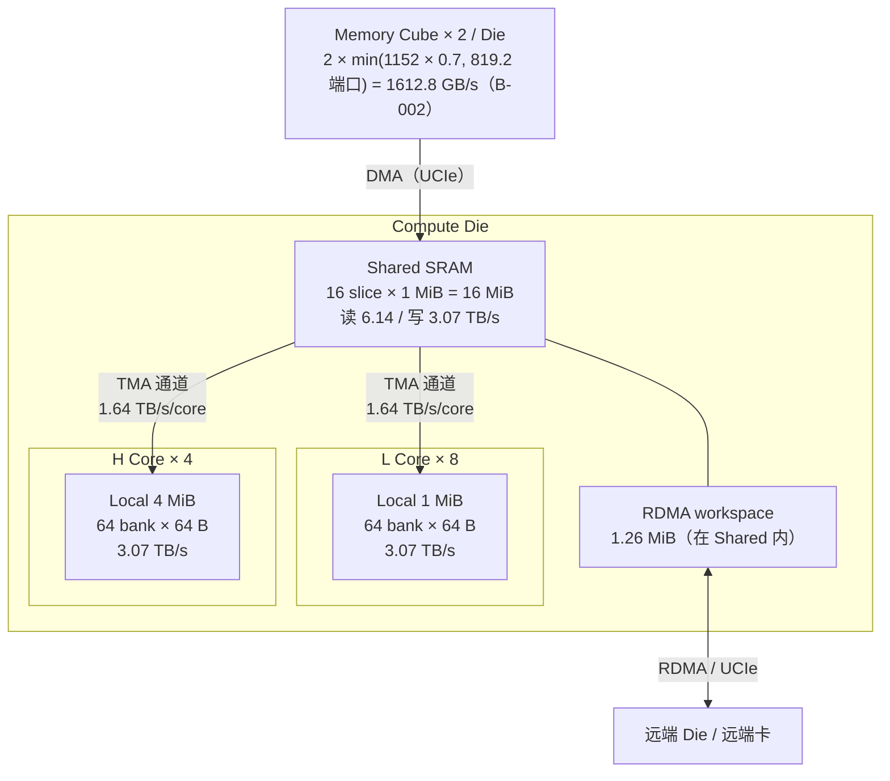
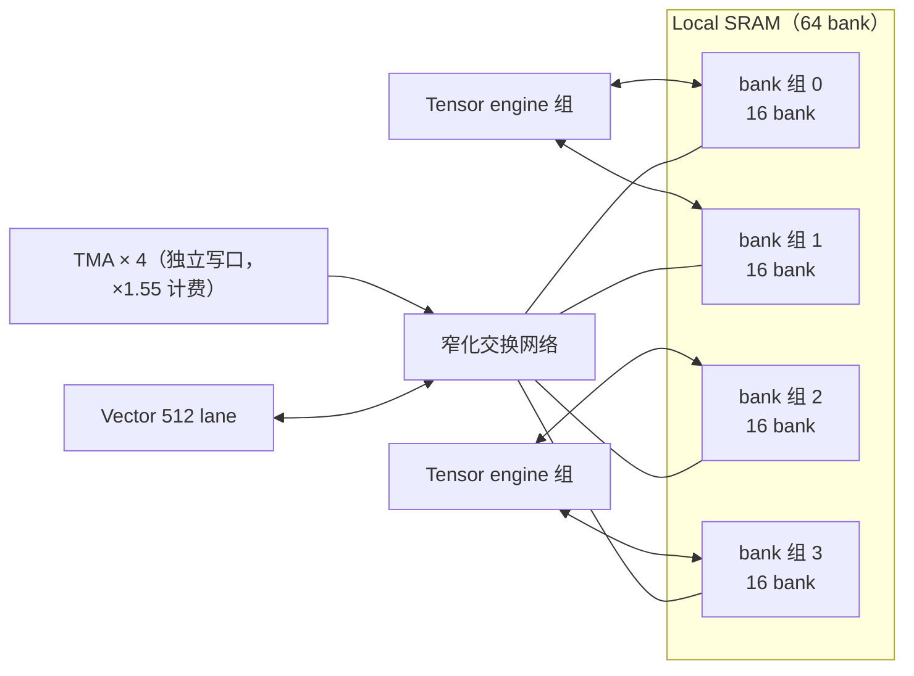
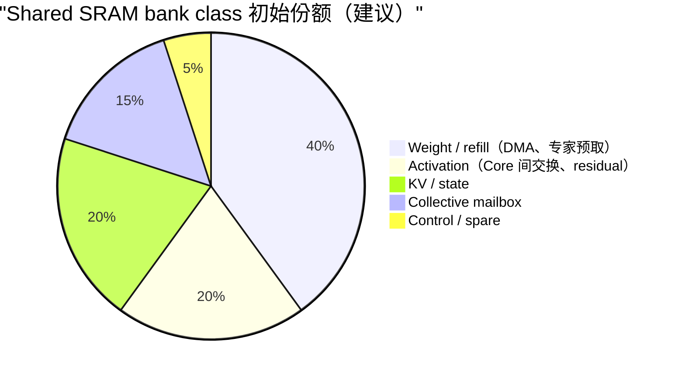
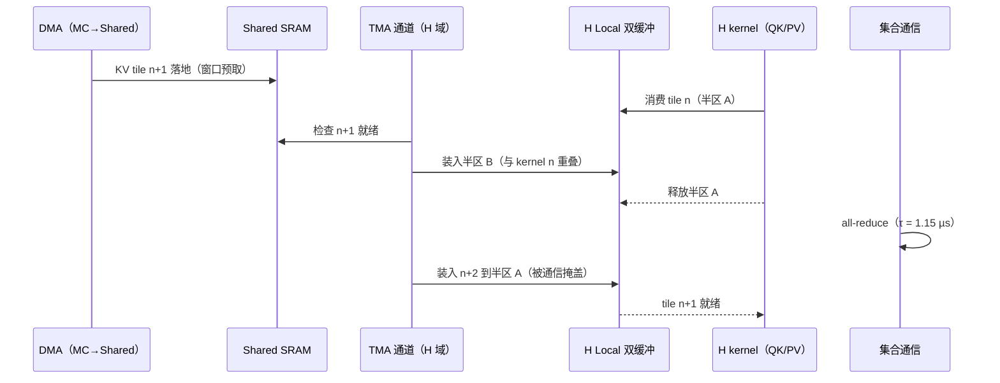
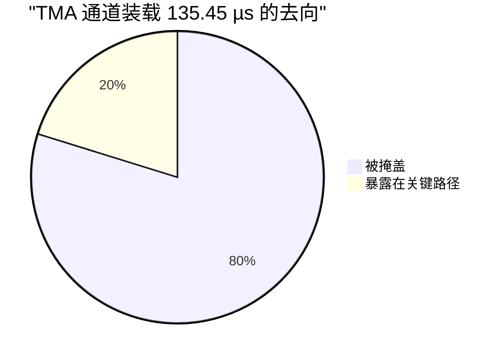
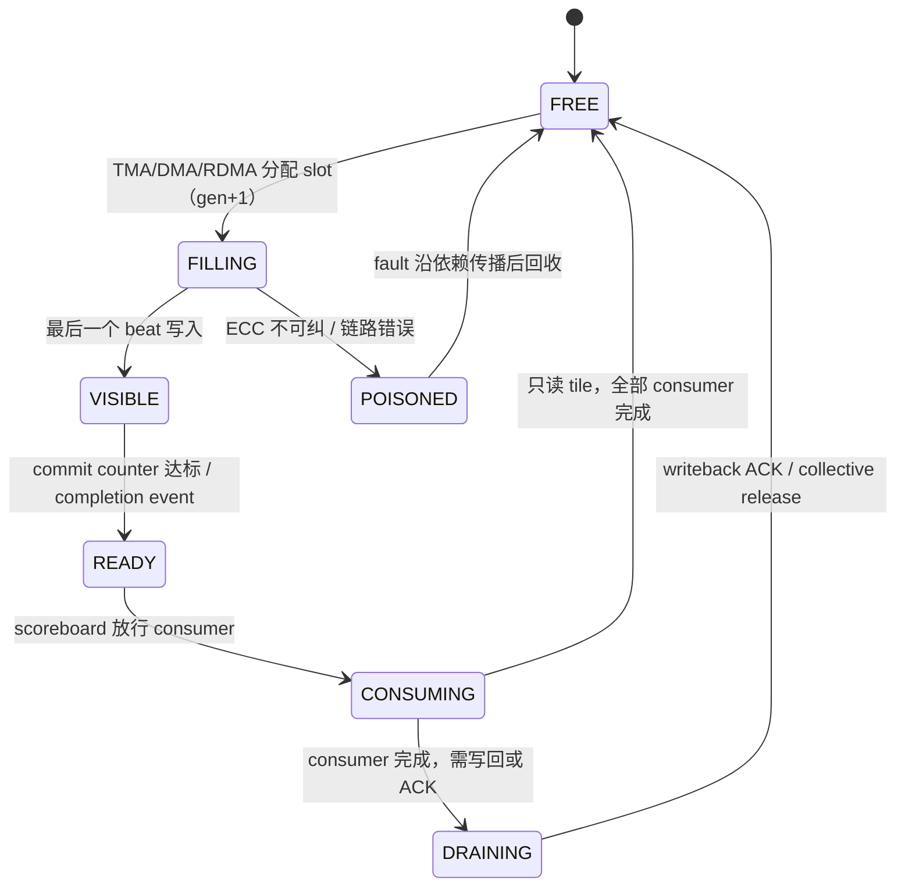
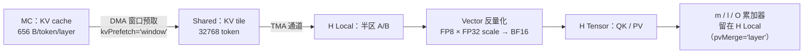
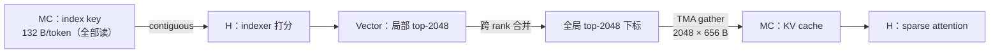

# TMA 与 SRAM 子系统设计

- 所有者：Hardware（SRAM/TMA）；共签：Software SW-02（调度）、SW-03（kernel）
- 状态：`BASELINE`（容量、带宽为模型值；bank-cycle 行为 `MODEL`，见 O-007）
- 数字口径：**唯一硬件规格 P1 的发布点**（ADR-0021），权威值在 `teams/hardware/inputs/k3_mc_baseline.json#tpsDesign.hardware`，
  文字说明见 [`21_TPS_DESIGN_BASELINE.md`](../../../docs/architecture/21_TPS_DESIGN_BASELINE.md) 第 3.3、3.4、4.4 节。

## 1. 存储层级总览



| 层级 | 容量（每 Die） | 带宽 | 设计用途 |
| --- | --- | ---: | --- |
| L Local | 8 × 1 MiB = 8 MiB | 3.07 TB/s/core | 权重 tile 双缓冲、激活、量化 scale |
| H Local | 4 × 4 MiB = 16 MiB | 3.07 TB/s/core | KV tile 双缓冲、m/l/O 累加器、state tile |
| Shared | 16 slice × 1 MiB = 16 MiB | 读 6.14 / 写 3.07 TB/s | DMA 落地、预测专家、KV、state、集合通信 workspace |
| **合计** | **40 MiB** | — | — |

整卡 8 Die 合计 320 MiB 数据 SRAM，其中 Shared 128 MiB。ECC、metadata parity、scrub 和 spare 不含在上述数据容量内。

带宽推导（1.0 GHz）：

```text
Local 读   64 bank × 64 B × 1.0 GHz × 0.75（bank 利用率）       = 3.07 TB/s/core
TMA        4 engine × 512 B/cycle × 1.0 GHz = 2.05 TB/s × 0.8   = 1.64 TB/s/core
Shared 窗口 8 Die × 16 MiB × 0.85                                = 108.80 MiB/卡（峰值预留 108.65）
```

### 1.1 占用

```mermaid
xychart-beta
  title "发布点 SRAM 占用（MiB）：容量 vs 峰值使用"
  x-axis ["L Local / core", "H Local / core", "Shared 窗口 / 卡 ÷ 10"]
  y-axis "MiB" 0 --> 12
  bar [1, 4, 10.88]
  bar [0.36, 2.74, 10.02]
```



第一组为容量（Shared 为 0.85 可用窗口），第二组为发布点峰值占用。Shared 除以 10 只为同轴显示。

- L Local 只用 36%：L 算子是权重流式 GEMV，tile 小。下一轮可以缩小 L Local，把面积让给 H 或 Shared（需 ADR-0005 变更流程）。
- H Local 用 69%：KV tile 32768 × FP8 656 B 的双缓冲加 m/l/O。改成 BF16 KV（1152 B）放不下（21 号文档第 5 节）。
- Shared 窗口用 92%：它是 DMA 预取深度和 KV 窗口预取的实际约束（21 号文档第 4.5 节）。

## 2. Local SRAM

### 2.1 bank 组织

- 64 bank × 64 B/cycle，按 Tensor engine 邻近分组；
- 每组独立 bank crossbar，再通过窄化交换网络连 TMA 与 Vector；
- 不把 64 bank 合成一条超宽全局总线。



4 组 × 16 bank 是建议的初始划分，不是冻结值（O-005、O-007）。

### 2.2 仲裁类

| 仲裁类 | 读/写 | 优先级（建议） | 说明 |
| --- | --- | --- | --- |
| Tensor operand | 读 | 1 | 关键路径 |
| Tensor 输出 / m/l/O | 写 | 2 | 累加器写回 |
| Vector | 读写 | 2 | unpack、softmax、epilogue |
| TMA fill | 写 | 3（有 watermark 时升为 1） | 独立端口 |
| TMA drain | 读 | 3 | 写回 Shared |
| ECC scrub / debug | 读写 | 4 | 仅空闲周期 |

## 3. Shared SRAM

- 16 slice/Die，每 slice 1 MiB；地址按 stripe 在 slice 间交织，slice home + bank interleave；
- 同时承担 MC refill、跨 Core tile、collective mailbox 和 writeback；
- Weight、Activation、KV/Partial、RDMA mailbox 采用 bank color 隔离。

建议初始 bank class（比例需由 trace 回标，不作为永久硬分区）：



### 3.1 端口放大计费

模型按以下系数给 Shared 端口计费（21 号文档第 3.3 节）：

| 参数 | 值 | 含义 |
| --- | ---: | --- |
| `localWriteRatio` | 1（原 1.70，ADR-0023） | local 写与读的比 |
| `tmaDedicatedPort` | ×1.55 | TMA 独立端口的写侧放大 |
| `sharedReadScale` | 1.18 | shared 读放大 |
| `sharedReadPerWrite` | 0.18 | 每次写附带的读 |

代价：每 Die 7.78 mm²（SF4）、2.74 W，每卡 21.92 W；全部关掉 TPS 只从 1124.70 降到 1124.69。
`localWriteRatio` 从 1.70 降到 1 已由 ADR-0023 回收（每 Die 8.37 mm²、2.95 W，TPS 不变）；其余三项是否继续回收走 ADR-0005 变更流程。

## 4. TMA

### 4.1 基线

每 Core 4 个 TMA engine，每 engine 512 B/cycle，1.0 GHz，逻辑峰值 2.05 TB/s/core，模型按 0.8 效率取 1.64 TB/s/core。
实际上限取 Local 写口、Shared slice、NoC 和 MC 中最慢的一项，不能把 engine 数直接叠加。

TMA descriptor 最少支持：

- contiguous、2D/3D strided；
- gather/scatter（GLM/DS 的 sparse KV gather，656 B 粒度）；
- multicast 到多个 Local SRAM；
- dtype convert/dequant；
- zero/padding；
- source/destination bounds；
- completion event、dependency token；
- poison/ECC error；
- partial-ready watermark。

建议字段布局（`OPEN`，由 [`TILE_IR.md`](../../../docs/architecture/contracts/TILE_IR.md) 冻结）：

```text
 0      63 64    127 128      191 192   223 224 239 240 247 248 255
+---------+---------+-----------+-------+-------+-------+-------+
| src addr| dst addr| dim0/1/2  |stride | dtype | dep   | flags |
|  64 b   |  64 b   | 3 × 21 b  | 32 b  | cvt   | token | poison|
+---------+---------+-----------+-------+-------+-------+-------+
```

### 4.2 独立 TMA 通道（`tmaLane`）

由 DMA 取入 Shared 的输入（权重、routed expert、KV tile、线性注意力 state）从算子中拆出，
放到 L、H 两个域各一条的 TMA 通道上，按程序顺序提前发射（21 号文档第 4.4 节）。发射条件：

1. 输入已在 Shared 就绪；
2. 该域 Local 双缓冲有空闲的一半。



发布点装载共 135.45 µs，其中 108.07 µs 被集合通信或前一 kernel 掩盖，暴露 27.37 µs。
单独关掉 `tmaLane`，TPS 从 1124.70 跌到 974.25，是所有机制里影响最大的一项。



兜底规则：已装满但属于后续算子的 tile 会钉住它的输入；head 算子需要的 DMA 因此装不下时，取消最远的一次装载（`tmaCancels`，发布点 0 次）。

## 5. Buffer 生命周期

每类 tile 使用 generation-tagged slot：



以下对象不能隐式 alias：

- 正在接收的 RDMA slot；
- 未完成 Tensor/Vector 消费的 Local tile；
- 未 ACK 的 writeback；
- online softmax 的 m/l/O；
- 预测专家命中尚未确认的有效部分。

## 6. KV、index key 与 state 布局

### 6.1 FP8 KV 路径



每 token 每层 656 B 的布局（FlashMLA）：

```text
+------------------------------+---------------+------------------+
| 512 × FP8 E4M3 latent        | 4 × FP32 scale| 64 × BF16 RoPE   |
| 512 B                        | 16 B          | 128 B            |
+------------------------------+---------------+------------------+
  每 128 个 latent 元素一个 scale                      合计 656 B
```

### 6.2 GLM-5.2 / DeepSeek-V4-Pro 的 index key 与 sparse gather

- index key：FP8 128 维 + 1 个 FP32 scale = 132 B/token/layer；GLM 只在 21 个 full 层缓存，DS 在全部 61 层缓存（`ASSUMPTION`）。
- indexer 读全部已缓存 index key（流式，适合 TMA contiguous）；attention 只读 top-k 2048 个 KV（TMA gather，656 B 粒度随机读）。



### 6.3 每 rank 容量（TP32，context 1M）

context 按 TP rank 切分。KV = 层数 × 656 B × 2²⁰ token ÷ 32；index key 同理用 132 B。

| 模型 | KV 层数 | KV / rank | index key / rank | 每 token 读 KV / rank | 来源 |
| --- | ---: | ---: | ---: | ---: | --- |
| K3 | 24（softmax MLA） | 0.516 GB | — | 0.516 GB（全量） | `tpsDesign`；69 层 KDA state 另计 |
| GLM-5.2 | 78 | 1.677 GB | 0.091 GB（21 层） | top-k 2048 × 656 B × 78 层（约 0.1 GB 全局） | 推导，`ASSUMPTION` |
| DeepSeek-V4-Pro | 61 | 1.311 GB | 0.264 GB（61 层） | top-k 2048 × 656 B × 61 层（约 0.08 GB 全局） | 推导，`ASSUMPTION` |

读法：K3 每 token 要把全部 24 层 KV 读一遍（0.516 GB/rank，占 4.97 GB 的 10%）；GLM/DS 的 sparse attention 只读 top-k，
但 indexer 的 index key 仍是全量读。权重和总容量对照见 [04](04_MEMORY_SUBSYSTEM_MC.md) 第 3 节。

## 7. 端口和冲突模型

需要独立量化：

- Tensor read/write；
- Vector read/write；
- TMA fill/drain；
- collective reduce read/write；
- ECC scrub；
- debug/repair。

第 3.1 节的系数必须替换成 bank-cycle 仿真结果。验收时报告平均值、P95、P99 和最坏 bank conflict，而不是只给总 TB/s。

## 8. SRAM 设计空间与搜索（HW-03 决策）

- 所有者：Hardware HW-03（SRAM/TMA）；共签：HW-04（MC 子系统）、SW-02（调度）、SW-03（kernel）
- 状态：`MODEL`（设计空间搜索：L1 合同 `B-SRAM-CAP` + K3 详细回放对照合同目标 + `B-AREA` 包络；不是 `FROZEN`，不改发布点）
- 设计空间（全部备选及其 ASSUMPTION）：`teams/hardware/inputs/sram_design_space.json`（哈希 `5aca5129e949`）——**`UNVERIFIED`，由 agent 依仓库文档起草，待域 owner 复核**
- 搜索：`integration/detailed/sram_search.js`；`npm run sram:search` 只把最终方案写到
  `out/detailed/sram_design.json`，整个打分的候选集写到 `out/detailed/sram_candidates.json`
  （带 `candidateSetSha256`）。本节数字由 `tests/regression/test_sram_design.js` 对照新鲜搜索结果检查。

**合同条款**：本域对 L1 合同的 `B-SRAM-CAP` 负责——每 Die Shared SRAM 窗口 ≥ 16 MiB
（`out/requirements/budget_frontier.json` 的 S-CMP 拆分，prefetch depth 4；发布点被集合通信约束、窗口压力小，但合同下限回到 16 MiB，网格的 12 MiB 因此落在下限以下）。
窗口是本空间的一个维度，所以条款直接检查：低于下限的候选记 `belowContractCapacity`，不回放。
回放只要求达到合同的 `target.tpsPerUser`（1000），**不要求保持发布点的 1138.48**——发布点是结果，不是需求。
Die 面积与功耗上限属于 `B-AREA`（physical 的条款），这里只作为共享包络读取；
面积和功耗都含 `O.chargeSharedPortCost()` 的端口放大计费（`A.physical()` 不带这一项）。

**目标**：可行优先，然后 Die 面积最小（含端口计费），然后 Die 功耗最小。
搜索共 486 个组合、324 个回放、304 个可行。网格 {12, 16, 24} 里 12 MiB 低于下限，它那一层不回放，所以记 `belowContractCapacity` 的候选有 162 个。不可行原因（一个候选可有多条）：

| 原因 | 候选数 |
| --- | ---: |
| `belowContractCapacity` | 162 |
| `belowContractTarget` | 18 |
| `diePower` | 2 |

### 8.1 最终方案

| 维度 | 选项 |
| --- | --- |
| `sharedMiB` | `12` |
| `lBanks` | `32` |
| `hBanks` | `16` |
| `sharedSlices` | `8` |
| `tmaEngines` | `1` |
| `sharedPortScaling` | `off` |

- K3 回放 1023.10 TPS/usr（发布值 1138.48），raw 835.41 µs；高于合同目标 1000 共 23.10，低于架构门 1050 共 26.90。
- Die 312.238 mm² / 268.347 W，卡 2854.871 W；端口放大不建，计费 0.000 mm²。
- 发布点的 SRAM 组合（`16 / 64 / 64 / 16 / 4 / published`）在搜索中排第 233 名：
  比最终方案多 49.441 mm²、24.128 W，多换来 115.39 TPS/usr。

读法：

- 最终方案是"满足合同的最便宜的 Die"，它把 1000 的合同余量用掉大半（只剩 23.10），且不过 1050 的架构门。
  这是按合同打分的预期结果，不是建议把发布点换成它。
- 这个结论只在**发布点的计算侧**成立。它与 compute、mc、comm、physical 各自的胜者能否同时成立，
  是 L3 `design.coupling`（P5）的问题；单域搜索不回答。
- 省下的 49 mm² 是 SRAM 域交给 physical 的余量，不是本域可以自行花掉的面积。

### 8.2 `B-SRAM-CAP` 扫描（其余维度固定在最终方案）

合同的判定来自 S-CMP 拆分点（计算侧放宽），这里的回放在发布点的计算侧，所以两者可以不一致。
本表把低于下限的窗口也强制回放，只为说明这一点；搜索本身不回放它们（下限现在是 16 MiB，网格的 12 MiB 落在下面，那 162 个候选不回放）。

| sharedMiB | 合同判定 | 回放 TPS/usr | Die 面积 mm² |
| ---: | --- | ---: | ---: |
| 8 | 不成立 | 745.17 | 304.317 |
| 10 | 不成立 | 866.45 | 306.297 |
| 12 | 不成立 | 868.60 | 308.277 |
| 13 | 不成立 | 1018.08 | 309.267 |
| 14 | 不成立 | 1022.10 | 310.258 |
| 16 | 成立 | 1023.10 | 312.238 |
| 20 | 成立 | 1023.30 | 316.199 |
| 24 | 成立 | 1023.30 | 320.159 |

14 MiB 在发布点计算侧回放能到合同目标（1022.10），但合同判定不成立（`holdsBySharedMiB` 在 14 不成立、16 起成立）：条款按合同裁决，不按本域的回放裁决。
若要下调窗口，应回到 L1 重新拆分 `B-SRAM-CAP`，而不是在本域搜索里放行。

### 8.3 本地容量（已裁定维度，用数字说明）

| L MiB | H MiB | 回放 TPS/usr | Die 面积 mm² | 结果 |
| ---: | ---: | ---: | ---: | --- |
| 1 | 4 | 1023.10 | 312.238 | **选中** |
| 2 | 4 | 1023.10 | 320.159 | 面积 |
| 4 | 4 | 1023.10 | 336.002 | 面积 |
| 8 | 4 | 1023.10 | 367.688 | 面积 |
| 1 | 1 | — | 300.356 | `hLocalTile` |
| 1 | 2 | 1023.10 | 304.317 | 面积 |
| 1 | 8 | 1023.10 | 328.081 | 面积 |

本地容量由 local tile 是否放得下决定：H 1 MiB 放不下 H tile；更大的容量 TPS/usr 不变，只多面积。
**H 2 MiB 在标称模型下放得下**（1023.10，面积比 H 4 MiB 少 7.92 mm²），但它在联合悲观重放下放不下 H tile，被 `search:final` 的稳健性约束（ADR-0026，`robust_model.js`）排除；所以发布点取 H 4 MiB 不是“最小可放下”，而是“最小稳健”。本表只判标称可行，不判稳健，因此 H 2 MiB 在这里显示为可行；是否该在本域也加稳健判定，留作后续。
所以它不进搜索维度（`ruled.localCapacity`）。

### 8.4 各备选的落选原因

每个选项把其余维度钉在最终方案上（`alternatives()` 的 `holdDims`）。

| 维度 | 选项 | 结果 | TPS/usr | Die 面积 mm² | Die 功耗 W | 卡功耗 W |
| --- | --- | --- | ---: | ---: | ---: | ---: |
| `sharedMiB` | `12` | `infeasible: belowContractCapacity` | — | — | — | — |
| `sharedMiB` | `16` | **选中** | 1023.10 | 312.238 | 268.347 | 2854.871 |
| `sharedMiB` | `24` | `die area` | 1023.30 | 320.159 | 269.067 | 2860.631 |
| `lBanks` | `16` | **选中** | 1023.10 | 312.238 | 268.347 | 2854.871 |
| `lBanks` | `32` | `die area` | 1063.45 | 315.508 | 271.726 | 2881.905 |
| `lBanks` | `64` | `die area` | 1080.50 | 322.048 | 278.484 | 2935.972 |
| `hBanks` | `16` | **选中** | 1023.10 | 312.238 | 268.347 | 2854.871 |
| `hBanks` | `32` | `die area` | 1044.21 | 313.873 | 270.036 | 2868.388 |
| `hBanks` | `64` | `die area` | 1050.34 | 317.143 | 273.416 | 2895.421 |
| `sharedSlices` | `8` | **选中** | 1023.10 | 312.238 | 268.347 | 2854.871 |
| `sharedSlices` | `16` | `infeasible: belowContractTarget` | 974.83 | 323.094 | 271.649 | 2881.290 |
| `sharedSlices` | `32` | `infeasible: belowContractTarget` | 971.33 | 341.275 | 277.256 | 2926.141 |
| `tmaEngines` | `1` | **选中** | 1023.10 | 312.238 | 268.347 | 2854.871 |
| `tmaEngines` | `2` | `die area` | 1029.44 | 317.603 | 269.307 | 2862.551 |
| `tmaEngines` | `4` | `die area` | 1029.44 | 328.332 | 271.227 | 2877.911 |
| `sharedPortScaling` | `published` | `die area` | 1023.10 | 316.126 | 269.717 | 2865.829 |
| `sharedPortScaling` | `off` | **选中** | 1023.10 | 312.238 | 268.347 | 2854.871 |

- 因合同目标落选的单项换到了 `sharedSlices`：切到 16 或 32 时 TPS/usr 跌到目标以下（974.83 / 971.33）。`lBanks` 16 现在是最小可行值——往上一档（32）要多 3.27 mm² 换 40.35 TPS/usr，按合同的面积优先排序输在面积上。
- 端口放大（`published`）在这里只换来 0.00 TPS/usr，却要 3.888 mm²（1023.10 对 1023.10，一个 TPS 都没买到）；与第 3.1 节在发布点的结论一致。
- `hBanks 32` 多 1.63 mm² 换 21.11 TPS/usr，`lBanks 32` 只多 3.27 mm² 就多 40.36 TPS/usr，后者是"余量优先"时最先该考虑的备选；按合同的排序它们输在面积上。

### 8.5 不搜索、已裁定的维度

理由在 `sram_design_space.json#ruled`：本地容量（第 8.3 节）、bank 宽度（由 SRAM compiler 决定，与 bank 数换的是同一份带宽）、
prefetch depth（`B-SRAM-CAP` 就是在 depth 4 上推导的；depth 拿窗口换 MC 带宽，属于 L3 的 SRAM × depth × MC 耦合）、
TMA 宽度（与引擎数换的是同一份填充带宽）。

## 9. 冻结交付物

- SRAM macro 组合、bank/slice/row 地址图；
- 所有端口和仲裁优先级（本文第 2.2 节为初版）；
- ECC、scrub、repair 和容量折损；
- TMA descriptor 格式和队列深度（本文第 4.1 节为初版）；
- 每个算子 tile 的 buffer 表与生命周期（本文第 5 节为初版）；
- bank-cycle 模型；
- 面积、动态功耗、泄漏和时序报告。
